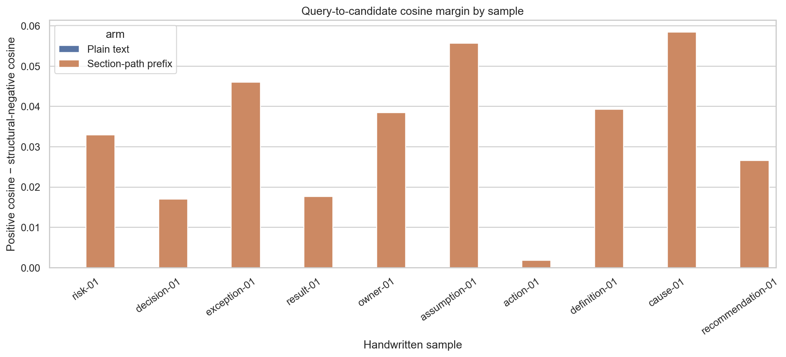
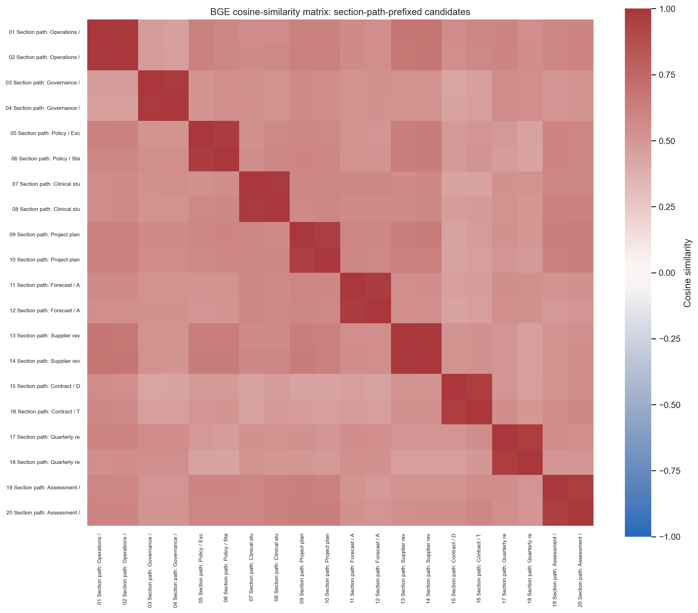
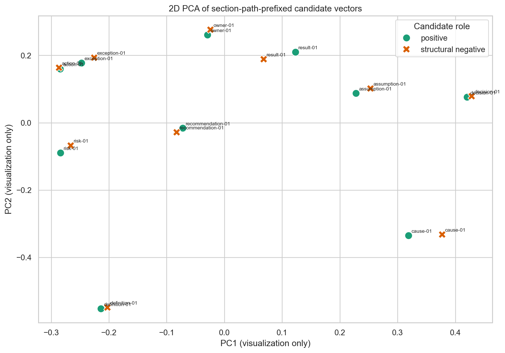
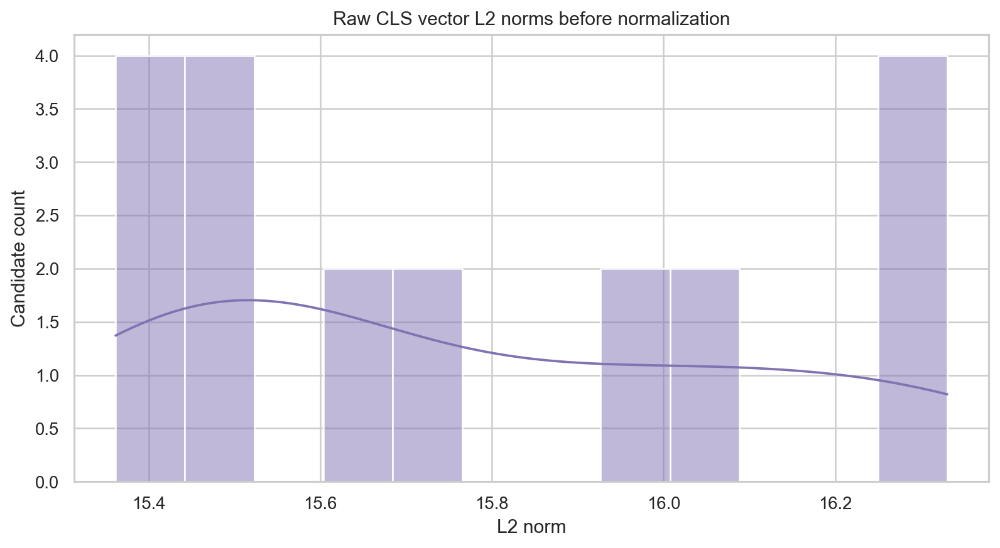

# Exploratory embedding vector-space analysis

## Setup

- Model: `BAAI/bge-base-en-v1.5`
- Snapshot: `a5beb1e3e68b9ab74eb54cfd186867f64f240e1a`
- Embedding size: 768 dimensions
- Pooling: last_hidden_state[:, 0, :] (CLS)
- Normalization: L2 normalization after CLS pooling; cosine is dot product of normalized vectors
- Device: `cuda` (`NVIDIA GeForce RTX 4070 Laptop GPU`)
- Handwritten structural pairs: 10
- Embedding pass time: 0.431 seconds
- Across-candidate normalized coordinate standard deviation (min/mean/max): 0.009239 / 0.022421 / 0.041422

## Pairwise results

| Arm | Pairwise accuracy | Ties | Mean positive-minus-negative cosine margin |
|---|---:|---:|---:|
| Plain candidate text | 0.000 | 10 | 0.000000 |
| Section-path prefix | 1.000 | 0 | 0.033386 |

### Per-pair cosine values

| Pair | Plain positive | Plain negative | Plain margin | Prefixed positive | Prefixed negative | Prefixed margin |
|---|---:|---:|---:|---:|---:|---:|
| risk-01 | 0.763250 | 0.763250 | 0.000000 | 0.770508 | 0.737592 | 0.032916 |
| decision-01 | 0.721900 | 0.721900 | 0.000000 | 0.738766 | 0.721711 | 0.017055 |
| exception-01 | 0.479328 | 0.479328 | 0.000000 | 0.587150 | 0.541156 | 0.045994 |
| result-01 | 0.601552 | 0.601552 | 0.000000 | 0.684829 | 0.667202 | 0.017627 |
| owner-01 | 0.578042 | 0.578042 | 0.000000 | 0.581883 | 0.543423 | 0.038460 |
| assumption-01 | 0.539773 | 0.539773 | 0.000000 | 0.635898 | 0.580220 | 0.055678 |
| action-01 | 0.732157 | 0.732157 | 0.000000 | 0.745305 | 0.743494 | 0.001811 |
| definition-01 | 0.813135 | 0.813135 | 0.000000 | 0.883816 | 0.844557 | 0.039259 |
| cause-01 | 0.733144 | 0.733144 | 0.000000 | 0.735778 | 0.677328 | 0.058449 |
| recommendation-01 | 0.503371 | 0.503371 | 0.000000 | 0.611971 | 0.585363 | 0.026608 |

## Figures

## Interpretation limits

Small hand-authored mechanism probe only. Positive and structural-negative candidate bodies are intentionally identical within each pair, so plain-text ties are an expected control. This is not an unbiased retrieval benchmark, does not test trained HiSE/SGAM, and has no statistical generalization claim.

The PCA chart is a projection for visualization, not a metric or proof of cluster separation. Cosine margins and pairwise accuracy describe only these ten constructed pairs. A genuine retrieval-quality claim requires a larger held-out query set and the same frozen chunks compared across plain-text, path-prefix, windowed-zero-SGAM, and trained HiSE arms.

Raw data: `vector_space_results.json`.
Per-vector arrays: `embedding_vectors.npz` (normalized query/candidate vectors and raw CLS vectors).
